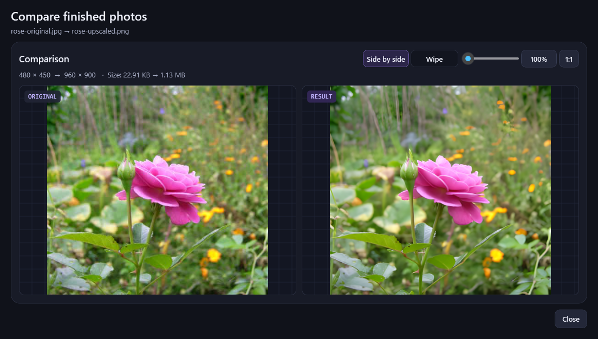

<h1 align="center">UpscaleHelper</h1>
<p align="center"><strong>Local photo and video upscaling for Windows</strong></p>
<p align="center">
  <a href="https://github.com/SerzLV/UpscaleHelper/releases/latest">Download for Windows</a> ·
  <a href="#quick-start">Quick start</a> ·
  <a href="README.ru.md">На русском</a>
</p>

Upscale photos and videos on your GPU, compare results side by side or frame by frame, and save smaller WebP copies of your photos. Media processing stays on your PC.



## What you can do

| Feature | What it does |
| --- | --- |
| **2× and 4× upscaling** | Choose Detail for photos and live-action footage, Fast 2× for shorter processing times, or Animation for drawn content. |
| **Photo comparison** | Use side by side, a draggable wipe, linked zoom, or a 1:1 view. Replace either photo in the same window or switch between the last ten pairs. |
| **Photo compression** | Preview a lossless or smaller WebP at the same resolution, compare file sizes, and save a separate copy. The lossless mode supports 8-bit photos. |
| **Photo restoration** | Open a photo and choose Improve photo for an automatic restoration preview with a wipe. Advanced settings include motion blur, strength, and optional 2× upscaling. |
| **Video comparison** | Try a 5- or 10-second clip with an estimate of the full export size, reopen a completed job, or load an existing pair. Pause or step through the source frames with linked zoom, a wipe, and a 1:1 view. |
| **Batch queue** | See frame progress and estimated time left. The queue and its completed results are restored when you reopen the app. |
| **Export options** | Save photos as PNG and SDR videos as H.264 MP4. Choose Compact, Balanced, or High quality for video and keep or remove audio. |

## Quick start

UpscaleHelper requires **Windows x64**, a Vulkan-capable GPU with current drivers, the [.NET 10 Desktop Runtime](https://dotnet.microsoft.com/download/dotnet/10.0), and [FFmpeg](https://ffmpeg.org/download.html) with `ffmpeg.exe` and `ffprobe.exe` on PATH.

Photo compression requires an FFmpeg build with the `libwebp` encoder.

1. Download and extract the Windows ZIP from [Releases](https://github.com/SerzLV/UpscaleHelper/releases).
2. Open PowerShell in the extracted folder and run `./setup-engines.ps1` once. It downloads the pinned Real-ESRGAN and Waifu2x releases and verifies their SHA-256 checksums.
3. Launch `UpscaleHelper.exe`, drop in files, choose a scale, and click **Upscale files** or press **F5**. The model and output folder are under **Advanced settings**. Results go into an `Upscaled` folder beside each source by default.

To continue working on a finished photo, choose **Improve**, **Draw details**, **Compress**, or **Compare** in its row. Use **Ctrl+P** to preview a selected video and **Ctrl+Shift+C** to compare files you already have. In the video comparison window, **←** and **→** step through frames. The **RU / EN** switch is in the top bar.

Click **Compress photo** in the toolbar to pick a file, or **Compress** in a photo row to use its latest result. Generate a preview, compare it with the source, and save a WebP copy. In **Smaller WebP** mode, type a quality from 1 to 100 or adjust it with **− / +** or **↑ / ↓**.

### Optional photo restoration

Run `./setup-restoration.ps1` once from the app folder for CPU processing, or `./setup-restoration.ps1 -Device Nvidia` for CUDA. The script installs the [Restormer models](https://github.com/swz30/Restormer) and a private runtime under `%LocalAppData%\UpscaleHelper\restoration`. The NVIDIA download is several gigabytes. Once installed, click **Improve photo** in the toolbar and choose an image, or click **Improve** in a photo row. In the restoration window, click **Improve photo** to start. The app chooses between defocus correction and noise reduction, then shows the preview with a wipe at the original resolution. Use **Advanced settings** to change the mode, strength, or scale before saving an 8-bit PNG copy. Restoration runs locally and accepts inputs up to 16 megapixels or 8,192 pixels per side, whichever limit is reached first.

**Draw details** is an optional experimental mode powered by [DiffBIR](https://github.com/XPixelGroup/DiffBIR). Install it with `./setup-restoration.ps1 -Device Nvidia -Generative`. It needs CUDA and downloads about 6.7 GB of additional model weights. It synthesizes texture and can change fine details. Try it on photos up to 2 MP, with a longest side of 1,600 pixels and an aspect ratio of 4:1 or less.

On first launch, the app uses Russian if Windows uses Russian and English otherwise. It remembers your language, model, scale, output folder, and video export settings. If processing fails, look for `%LocalAppData%\UpscaleHelper\logs\app.log`.

## Build from source

Install the [.NET 10 SDK](https://dotnet.microsoft.com/download/dotnet/10.0) and FFmpeg, then run these commands from the checkout.

```powershell
./setup-engines.ps1
dotnet run --project UpscaleHelper.csproj -c Release
dotnet test -c Release
```

You can also place `ffmpeg.exe` and `ffprobe.exe` in `tools/ffmpeg/`. The application looks beside the executable first, then uses PATH.

In Visual Studio, open `UpscaleHelper.slnx`, choose the **UpscaleHelper** launch profile, and press **F5**.

## Demo and credits

Try the [original photo](docs/demo/rose-original.jpg) and [2× result](docs/demo/rose-upscaled.png) with **Compare files**. The source photo is [Rose rosa by Rillke](https://commons.wikimedia.org/wiki/File:Rose_rosa.jpg), shared under [CC0 1.0](https://creativecommons.org/publicdomain/zero/1.0/). The original was resized and compressed for this example, then upscaled with the Detail model.

UpscaleHelper is built with C# and WPF. Its processing backends are [Real-ESRGAN](https://github.com/xinntao/Real-ESRGAN/releases/tag/v0.2.5.0), [Waifu2x ncnn Vulkan](https://github.com/nihui/waifu2x-ncnn-vulkan/releases/tag/20250915), and [FFmpeg](https://ffmpeg.org/). See the upstream terms for [Real-ESRGAN](https://github.com/xinntao/Real-ESRGAN/blob/master/LICENSE), [Real-ESRGAN ncnn Vulkan](https://github.com/xinntao/Real-ESRGAN-ncnn-vulkan/blob/master/LICENSE), [Waifu2x ncnn Vulkan](https://github.com/nihui/waifu2x-ncnn-vulkan/blob/20250915/LICENSE), and [FFmpeg](https://ffmpeg.org/legal.html).
