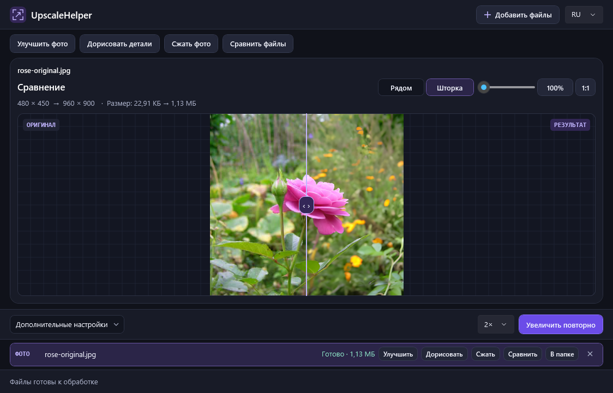

# UpscaleHelper

[English](README.md) · [Скачать для Windows](https://github.com/SerzLV/UpscaleHelper/releases/latest)

Локальное приложение для увеличения фото и видео на GPU. Можно обработать короткий фрагмент перед запуском всей очереди, а затем сравнить оригинал и результат. Обработка идёт на твоём ПК.



## Возможности

| Функция | Что можно сделать |
| --- | --- |
| **Апскейл 2× и 4×** | Выбрать «Детализация» для фото и реальной съёмки, «Быстрый 2×» для скорости или «Анимация» для рисованных кадров. |
| **Сравнение фото** | Смотреть рядом или через шторку, синхронно увеличивать детали, включать масштаб 1:1 и проверять разрешение и размер обоих файлов. |
| **Сравнение видео** | Обработать пробные 5 или 10 секунд, открыть результат из очереди или загрузить готовую пару. На паузе и при листании доступны кадры из обоих файлов, синхронный зум, шторка и масштаб 1:1. |
| **Очередь** | Видеть скорость, прогресс и оставшееся время. У готовых файлов отображаются время обработки и размер. |
| **Экспорт** | Сохранять фото в PNG и видео SDR в MP4 с H.264. Звук можно сохранить или убрать. |

## Быстрый запуск

Нужны **Windows x64**, видеокарта с Vulkan и актуальным драйвером, [.NET 10 Desktop Runtime](https://dotnet.microsoft.com/download/dotnet/10.0) и [FFmpeg](https://ffmpeg.org/download.html). Команды `ffmpeg.exe` и `ffprobe.exe` должны быть доступны через PATH.

1. Скачай и распакуй ZIP для Windows из раздела [Releases](https://github.com/SerzLV/UpscaleHelper/releases).
2. Открой PowerShell в распакованной папке и один раз запусти `./setup-engines.ps1`. Скрипт скачает закреплённые версии Real-ESRGAN и Waifu2x и проверит SHA-256.
3. Запусти `UpscaleHelper.exe`, добавь файлы, выбери модель и масштаб, затем нажми **F5**. По умолчанию результаты сохраняются в подпапку `Upscaled` рядом с исходником.

**Ctrl+P** открывает пробный фрагмент выбранного видео, **Ctrl+Shift+C** — сравнение двух готовых файлов. В окне видео клавиши **←** и **→** переключают кадры. Язык меняется переключателем **RU / EN** в верхней панели.

При первом запуске приложение выбирает русский для русскоязычной Windows, в остальных случаях английский. Оно запоминает язык, модель, масштаб, папку вывода и настройку звука. При ошибке обработки журнал можно найти в `%LocalAppData%\UpscaleHelper\logs\app.log`.

## Сборка из исходников

Установи [.NET 10 SDK](https://dotnet.microsoft.com/download/dotnet/10.0) и FFmpeg, затем выполни эти команды в папке проекта.

```powershell
./setup-engines.ps1
dotnet run --project UpscaleHelper.csproj -c Release
dotnet test -c Release
```

FFmpeg также можно положить в `tools/ffmpeg/`. Приложение сначала ищет его рядом с EXE, затем через PATH.

## Пример и источники

Для проверки **«Сравнить файлы»** можно взять [исходное фото](docs/demo/rose-original.jpg) и [результат 2×](docs/demo/rose-upscaled.png). Для демонстрации фото [Rose rosa](https://commons.wikimedia.org/wiki/File:Rose_rosa.jpg) автора Rillke уменьшено и сжато, а затем обработано моделью «Детализация». Исходное фото опубликовано по [CC0 1.0](https://creativecommons.org/publicdomain/zero/1.0/).

Приложение написано на C# и WPF. Ссылки на движки и их лицензии есть в [английском README](README.md#demo-and-credits).
